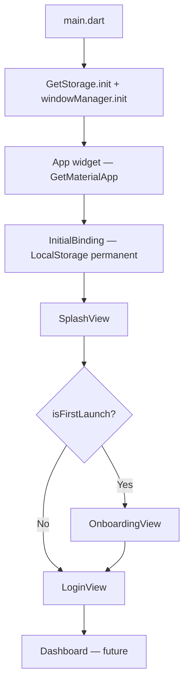
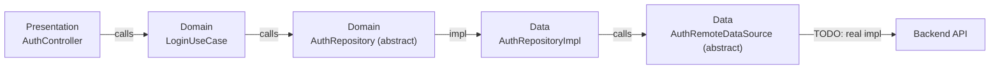

# BlinkERP — Project Structure & Architecture

> [!NOTE]
> Flutter Desktop/Mobile ERP app · GetX (state + DI + routing) · Clean Architecture · `window_manager` for custom title bar

---

## Tech Stack

| Layer | Package |
|---|---|
| State Management & DI | `get` (GetX) |
| Local Storage | `get_storage` |
| Window Control | `window_manager` |
| Localization | GetX translations (AR/EN) |
| Responsive | Custom `ResponsiveLayout` breakpoint |

---

## Directory Tree

```
lib/
├── main.dart                          # Entry point — init storage, windowManager, runApp
├── app/
│   ├── app.dart                       # Root widget — GetMaterialApp config (theme, locale, routes)
│   ├── bindings/
│   │   └── initial_binding.dart       # App-wide DI: registers LocalStorage as permanent
│   └── routes/
│       ├── app_routes.dart            # All named route strings (central registry)
│       └── app_pages.dart             # GetPage list — maps routes → views + bindings
│
├── core/
│   ├── constants/
│   │   ├── app_assets.dart            # Asset path constants
│   │   └── app_constants.dart         # Misc constants (e.g. splashDurationMs)
│   ├── localization/
│   │   ├── app_translations.dart      # Combines AR + EN maps
│   │   ├── ar.dart                    # Arabic strings
│   │   └── en.dart                    # English strings
│   ├── responsive/
│   │   ├── responsive_config.dart     # Breakpoints & content max-width
│   │   └── responsive_layout.dart     # Switches Mobile ↔ Desktop widget by width
│   ├── services/
│   │   └── storage_service.dart       # Alias for LocalStorage (legacy compat)
│   ├── storage/
│   │   └── local_storage.dart         # Typed GetStorage wrapper (auth, prefs, first-launch)
│   ├── theme/
│   │   ├── app_colors.dart            # Brand + semantic color palette (light/dark)
│   │   ├── app_theme.dart             # ThemeData (light + dark)
│   │   └── app_typography.dart        # TextTheme definitions
│   └── widgets/                       # Shared, feature-agnostic widgets
│       ├── brand_loading.dart
│       ├── brand_video.dart           # Native video player (video_player_win)
│       ├── custom_text.dart           # Text with auto .tr + theme-aware style
│       ├── language_switch.dart       # AR/EN toggle widget
│       ├── loading_text.dart
│       ├── support.dart               # SupportButton & SupportView
│       └── window_title_bar.dart      # CustomTitleBar + CustomTitleBarController (window_manager)
│
└── features/
    ├── splash/
    │   ├── bindings/splash_binding.dart
    │   ├── controllers/
    │   │   └── splash_controller.dart  # onReady → delay → navigate (onboarding or login)
    │   └── views/splash_view.dart
    │
    ├── onboarding/
    │   ├── bindings/onboarding_binding.dart
    │   ├── controllers/
    │   │   └── onboarding_controller.dart  # Pages list, currentPage, next/skip
    │   └── views/onboarding_view.dart      # Animated slides, dot indicators, CTA
    │
    └── auth/
        ├── data/
        │   ├── datasources/
        │   │   └── auth_remote_datasource.dart   # Abstract — ready for API impl
        │   ├── models/
        │   │   └── auth_user_model.dart           # AuthUser + fromJson/toJson
        │   └── repositories/
        │       └── auth_repository_impl.dart      # Delegates to remote datasource
        │
        ├── domain/
        │   ├── entities/
        │   │   └── auth_user.dart                 # Pure domain entity (no Flutter deps)
        │   ├── repositories/
        │   │   └── auth_repository.dart           # Abstract contract
        │   └── usecases/
        │       └── login_usecase.dart             # Single-responsibility login call
        │
        └── presentation/
            ├── bindings/auth_binding.dart          # lazyPut AuthController
            ├── controllers/
            │   └── auth_controller.dart            # Form state, validation, login flow
            ├── views/
            │   ├── login_view.dart                 # ResponsiveLayout → mobile | desktop
            │   ├── forgot_password.dart
            │   ├── otp_verification.dart
            │   ├── register_view.dart
            │   └── layouts/
            │       ├── mobile/login_mobile_layout.dart
            │       └── desktop/login_desktop_layout.dart
            └── widgets/
                ├── auth_text_field.dart
                └── login_form.dart                 # Shared form (email, password, CTA, socials)
```

---

## App Flow



---

## Routing

| Route Constant | Path | View |
|---|---|---|
| `AppRoutes.splash` | `/splash` | `SplashView` |
| `AppRoutes.onboarding` | `/onboarding` | `OnboardingView` |
| `AppRoutes.login` | `/login` | `LoginView` |
| `AppRoutes.register` | `/register` | `RegisterView` |
| `AppRoutes.forgotPassword` | `/forgotPassword` | `ForgotPasswordView` |
| `AppRoutes.otpVerification` | `/otpVerification` | `OtpVerificationView` |
| `AppRoutes.support` | `/support` | `SupportView` |

---

## Auth — Clean Architecture Layers



> [!IMPORTANT]
> `AuthRemoteDataSource` is still an **abstract class** with no real HTTP implementation.
> A mock/stub implementation must be wired in `AuthBinding` until the backend is ready.

---

## Responsive Strategy

- Breakpoint defined in `ResponsiveConfig.desktopBreakpoint`
- `ResponsiveLayout` widget switches between `mobile` and `desktop` slots based on `LayoutBuilder` width
- Each feature provides its own `*MobileLayout` and `*DesktopLayout`

---

## Window / Title Bar

- `window_manager` is initialized in `main.dart` with `TitleBarStyle.hidden` (custom title bar)
- `CustomTitleBar` widget lives in `core/widgets/window_title_bar.dart`
- `CustomTitleBarController` manages maximize / minimize / close / fullscreen state
- Should be placed at the **top of every desktop Scaffold** (inside a `Column`)

---

## LocalStorage Keys

| Key | Type | Purpose |
|---|---|---|
| `first_launch` | `bool` | Onboarding shown flag |
| `is_logged_in` | `bool` | Session persistence |
| `auth_token` | `String?` | JWT / session token |
| `app_language` | `String` | `'ar'` or `'en'` |
| `app_dark_mode` | `bool` | Theme preference |

---

## Known Issues / TODOs

- [ ] `AuthRemoteDataSource` has no concrete HTTP implementation — needs `AuthRemoteDataSourceImpl`
- [ ] `AuthBinding` doesn't wire `LoginUseCase` or `AuthRepository` — DI chain is incomplete
- [ ] `LoginForm.login()` passes empty strings as email/password — should read from controllers
- [ ] Email regex in `validateEmail` is broken (raw string escaping issue)
- [ ] Error message `Obx` checks `message == null` but `errorMessage` is `RxString` (never null)
- [ ] `CustomTitleBar` is not yet added to desktop login layout
- [ ] `_WindowButton.onTap` type is `VoidCallback` but window_manager calls are `Future<void>` — needs `AsyncCallback`
